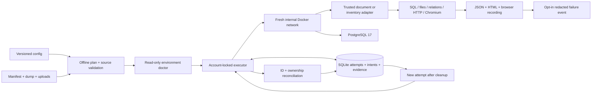

# Execution and recovery architecture

Backups never mount production paths into containers. The source bundle is copied into private staging and revalidated before restore. The database checker uses a separate read-only role. All application and browser operations use the internal network; image preparation happens earlier.

On an uncatchable crash, the next invocation reads pending attempts, discovers owned Docker IDs by label, verifies ownership and removes only those resources. Historical evidence remains inconclusive or failed; a retry cannot overwrite it with a later success.
